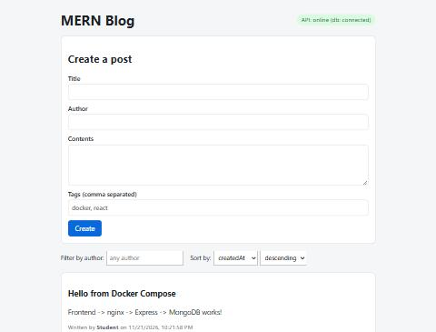
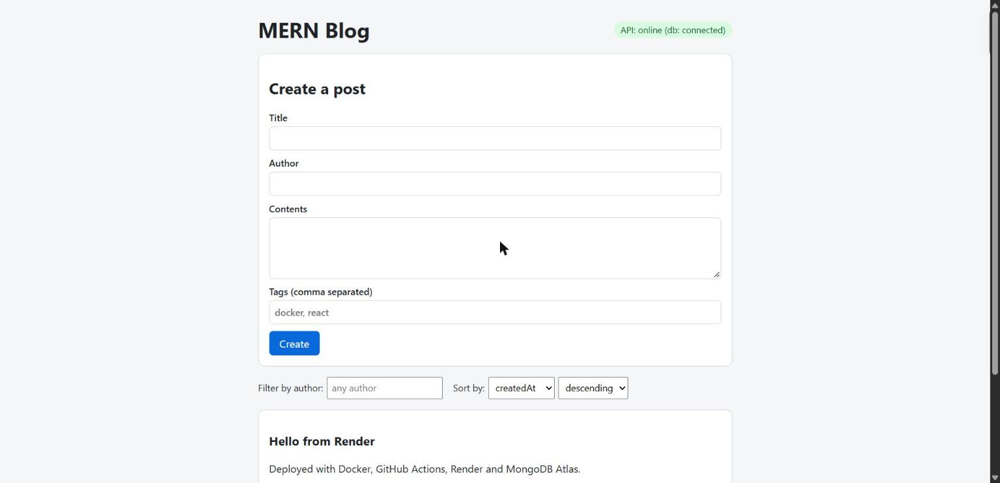

# Assignment 4 – Solution
**Web Application Projects with React (CSE 3395) · B.Tech CSIT 5th Sem · 2026–27**
**Topic:** Containerization, Cloud Deployment and CI/CD Automation of a MERN Stack Blog Application

> Every output in Tasks 1 and 2 and in the test run was captured on this machine
> (21 Nov 2026). Tasks 3–5 need personal Docker Hub, Render, MongoDB Atlas and
> GitHub accounts. For those tasks the exact commands and files are given; run them and
> paste in your own URLs and screenshots where marked **[fill in]**.

---

## Application overview

| Layer | Technology | Location |
|---|---|---|
| Database | MongoDB 7 (container) / MongoDB Atlas (cloud) | – |
| Backend | Node 20, Express 4, Mongoose 8 | `backend/` |
| Frontend | React 18, Vite 6, TanStack Query 5, served by nginx | `frontend/` |

REST API: `GET/POST /api/v1/posts`, `GET/PATCH/DELETE /api/v1/posts/:id`, `GET /api/v1/health`.

**Main backend code** – `backend/src/routes/posts.js`, abridged:
```js
router.get('/', async (req, res, next) => {
  const { author, tag, sortBy = 'createdAt', sortOrder = 'descending' } = req.query;
  const filter = {};
  if (author) filter.author = String(author);
  if (tag) filter.tags = String(tag);
  const field = ['createdAt', 'updatedAt', 'title'].includes(sortBy) ? sortBy : 'createdAt';
  res.json(await Post.find(filter).sort({ [field]: sortOrder === 'ascending' ? 1 : -1 }));
});

router.post('/', async (req, res, next) => {
  try {
    const post = await Post.create(pickPostFields(req.body));
    res.status(201).json(post);
  } catch (err) { next(err); }   // ValidationError -> 400
});
```

**Main frontend code** – TanStack Query in `frontend/src/App.jsx` and `components/CreatePost.jsx`:
```jsx
const postsQuery = useQuery({
  queryKey: ['posts', { author, sortBy, sortOrder }],
  queryFn: () => getPosts({ author, sortBy, sortOrder }),
});

const createPostMutation = useMutation({
  mutationFn: () => createPost({ title, author, contents, tags }),
  onSuccess: () => queryClient.invalidateQueries({ queryKey: ['posts'] }),
});
```
The frontend always calls the relative path `/api/v1/...` (`src/api/posts.js`). nginx in the
frontend container forwards `/api/` to `$BACKEND_URL`. The same image therefore works in
Docker, Docker Compose and Render (or Cloud Run), and only an environment variable changes.

---

## Task 1 – Docker Containerization

### 1(a) Dockerfile for the backend – `backend/Dockerfile`
```dockerfile
# ---------- Backend: Node.js + Express API ----------
FROM node:20-alpine

WORKDIR /app
ENV NODE_ENV=production

# Install only production dependencies (separate layer => better build cache)
COPY package*.json ./
RUN npm ci --omit=dev && npm cache clean --force

# Copy the application source
COPY src ./src

# Locally the API listens on 3001; Cloud Run overrides PORT (8080)
ENV PORT=3001
EXPOSE 3001

# Run as the unprivileged "node" user that ships with the image
USER node

CMD ["node", "src/server.js"]
```

### 1(b) Dockerfile for the React frontend – `frontend/Dockerfile` (multi-stage)
```dockerfile
# ---------- Stage 1: build the React app with Vite ----------
FROM node:20-alpine AS build
WORKDIR /app
COPY package*.json ./
RUN npm ci
COPY . .
RUN npm run build

# ---------- Stage 2: serve the static build with nginx ----------
FROM nginx:1.27-alpine
COPY nginx/default.conf.template /etc/nginx/templates/default.conf.template
COPY --from=build /app/dist /usr/share/nginx/html
ENV PORT=8080
ENV BACKEND_URL=http://backend:3001
ENV NGINX_ENVSUBST_FILTER="^(PORT|BACKEND_URL)$"
EXPOSE 8080
```
`frontend/nginx/default.conf.template`. At start-up nginx fills in `${PORT}` and `${BACKEND_URL}`:
```nginx
server {
    listen ${PORT};
    root /usr/share/nginx/html;
    index index.html;

    location /api/ {                       # reverse-proxy to the Express API
        proxy_pass ${BACKEND_URL};
        proxy_ssl_server_name on;          # needed for an HTTPS backend (Render / Cloud Run)
        proxy_http_version 1.1;
        proxy_set_header X-Forwarded-For $proxy_add_x_forwarded_for;
        proxy_set_header X-Forwarded-Proto $scheme;
    }
    location / {                           # SPA fallback
        try_files $uri $uri/ /index.html;
    }
}
```

### 1(c) `.dockerignore` files
`backend/.dockerignore`
```
node_modules
npm-debug.log*
coverage
tests
.env
.env.*
.git
.gitignore
.dockerignore
Dockerfile
eslint.config.js
*.md
```
`frontend/.dockerignore`
```
node_modules
dist
npm-debug.log*
.env
.env.*
.git
.gitignore
.dockerignore
Dockerfile
*.md
```
These keep the build context small, stop the host's `node_modules` from overwriting the
container's, and keep secrets such as `.env` out of the images.

### 1(d) Build the images and create the containers

**Commands**
```powershell
docker build -t blog-backend ./backend
docker build -t blog-frontend ./frontend
docker network create blog-net
docker run -d --name t1-mongo    --network blog-net mongo:7
docker run -d --name t1-backend  --network blog-net -p 4001:3001 -e DATABASE_URL=mongodb://t1-mongo:27017/blog blog-backend
docker run -d --name t1-frontend --network blog-net -p 4000:8080 -e BACKEND_URL=http://t1-backend:3001 blog-frontend
```

**Output – backend build**
```
#5 [1/5] FROM docker.io/library/node:20-alpine
#6 [2/5] WORKDIR /app
#7 [3/5] COPY package*.json ./
#8 [4/5] RUN npm ci --omit=dev && npm cache clean --force
#9 [5/5] COPY src ./src
#10 naming to docker.io/library/blog-backend:latest done
```
**Output – frontend build**
```
#7  [build 1/6] FROM docker.io/library/node:20-alpine
#11 [build 3/6] COPY package*.json ./
#8  [build 4/6] RUN npm ci
#12 [build 5/6] COPY . .
#13 [build 6/6] RUN npm run build
#9  [stage-1 2/3] COPY nginx/default.conf.template /etc/nginx/templates/default.conf.template
#14 [stage-1 3/3] COPY --from=build /app/dist /usr/share/nginx/html
#15 naming to docker.io/library/blog-frontend:latest done
```
**Output – `docker images`**
```
REPOSITORY:TAG          IMAGE ID       SIZE
blog-frontend:latest    9fba3b77a272   73.9MB
blog-backend:latest     aa026833f5df   216MB
```
**Output – `docker ps`**
```
NAMES         IMAGE           STATUS          PORTS
t1-frontend   blog-frontend   Up 4 seconds    0.0.0.0:4000->8080/tcp
t1-backend    blog-backend    Up 6 seconds    0.0.0.0:4001->3001/tcp
t1-mongo      mongo:7         Up 13 seconds   27017/tcp
```
**Output – `docker logs t1-backend`**
```
Connected to MongoDB
Express server running on port 3001
```

### 1(e) Check that the frontend communicates with the backend API
The requests below go to the frontend container on port 4000. nginx forwards them to the
backend container, which writes to MongoDB.
```
$ curl -X POST http://localhost:4000/api/v1/posts -H "Content-Type: application/json" \
       -d '{"title":"Standalone containers","author":"Student","contents":"Frontend container talks to backend container","tags":["docker"]}'
{"title":"Standalone containers","author":"Student","contents":"Frontend container talks to backend container","tags":["docker"],"_id":"6b01cd07039fa7f63af80535","createdAt":"2026-11-21T16:55:35.609Z","updatedAt":"2026-11-21T16:55:35.609Z","__v":0}

$ curl http://localhost:4000/api/v1/posts
[{"_id":"6b01cd07039fa7f63af80535","title":"Standalone containers",...}]

$ curl http://localhost:4000/api/v1/health
{"status":"ok","database":"connected"}
```
**Result:** the frontend, backend and MongoDB communicate. ✅

---

## Task 2 – Docker Compose Configuration

### 2(a)(b) `docker-compose.yml` – services, dependencies, ports, env vars, DB connectivity
```yaml
services:
  mongo:
    image: mongo:7
    container_name: blog-mongo
    restart: unless-stopped
    ports:
      - "27017:27017"
    volumes:
      - mongo-data:/data/db                    # persistent database
    healthcheck:
      test: ["CMD", "mongosh", "--quiet", "--eval", "db.adminCommand('ping').ok"]
      interval: 10s
      timeout: 5s
      retries: 5
      start_period: 10s

  backend:
    build: ./backend
    image: ${DOCKERHUB_USERNAME:-local}/blog-backend:latest
    container_name: blog-backend
    restart: unless-stopped
    environment:
      PORT: 3001
      DATABASE_URL: mongodb://mongo:27017/blog  # service name = hostname
      CORS_ORIGIN: "*"
    ports:
      - "3001:3001"
    depends_on:
      mongo:
        condition: service_healthy              # wait for DB to be ready

  frontend:
    build: ./frontend
    image: ${DOCKERHUB_USERNAME:-local}/blog-frontend:latest
    container_name: blog-frontend
    restart: unless-stopped
    environment:
      PORT: 8080
      BACKEND_URL: http://backend:3001
    ports:
      - "3000:8080"
    depends_on:
      - backend

volumes:
  mongo-data:
```

### 2(c) Start and manage the services
```powershell
docker compose up -d --build     # build + start
docker compose ps                # status
docker compose logs -f backend   # logs
docker compose restart backend   # restart one service
docker compose down              # stop (add -v to delete DB volume)
```
**Output – `docker compose up -d --build`**
```
 Volume assignment4_mongo-data   Created
 Network assignment4_default     Created
 Container blog-mongo     Created
 Container blog-backend   Created
 Container blog-frontend  Created
 Container blog-mongo     Started
 Container blog-mongo     Waiting
 Container blog-mongo     Healthy
 Container blog-backend   Started
 Container blog-frontend  Started
```
**Output – `docker compose ps`**
```
NAME            IMAGE                        STATUS                   PORTS
blog-backend    local/blog-backend:latest    Up 3 minutes             0.0.0.0:3001->3001/tcp
blog-frontend   local/blog-frontend:latest   Up 3 minutes             0.0.0.0:3000->8080/tcp
blog-mongo      mongo:7                      Up 4 minutes (healthy)   0.0.0.0:27017->27017/tcp
```

### 2(d) The Blog Application working in the containerized environment
```
$ curl http://localhost:3001/api/v1/health
{"status":"ok","database":"connected"}

$ curl -X POST http://localhost:3000/api/v1/posts -H "Content-Type: application/json" \
   -d '{"title":"Hello from Docker Compose","author":"Student","contents":"Frontend -> nginx -> Express -> MongoDB works!","tags":["docker","mern"]}'
{"title":"Hello from Docker Compose","author":"Student", ... ,"_id":"6b01cc2e7da7648457d42949","createdAt":"2026-11-21T16:51:58.218Z", ...}

$ curl http://localhost:3000/api/v1/posts
[{"_id":"6b01cc2e7da7648457d42949","title":"Hello from Docker Compose", ...}]
```
Browser at **http://localhost:3000**: the status badge reads *API: online (db: connected)*,
and the post that was created is listed. Screenshot: `screenshots/app-docker-compose.jpg`



---

## Task 3 – Cloud Deployment (Render)

> The question names Google Cloud Run, which needs a billing card. This project is
> deployed on **Render** instead. Render also runs Docker containers as public HTTPS
> web services and has a free tier with no card. The Docker images are unchanged; the
> same `gcloud run deploy` commands still work if Cloud Run is required (see README.md §4).

### 3(a) MongoDB Atlas
1. Go to cloud.mongodb.com, choose **Create**, then the **M0 Free** cluster.
2. **Database Access:** add a user, e.g. `bloguser`, with a password.
3. **Network Access:** add `0.0.0.0/0`. Render has no fixed outbound IP.
4. **Connect, then Drivers:** copy the connection string and add the DB name `blog`:
   `mongodb+srv://bloguser:<password>@cluster0.xxxxx.mongodb.net/blog?retryWrites=true&w=majority`

### 3(b) Docker Hub repositories and image push
```powershell
docker login
docker build -t <dockerhub-user>/blog-backend:latest  ./backend
docker build -t <dockerhub-user>/blog-frontend:latest ./frontend
docker push <dockerhub-user>/blog-backend:latest
docker push <dockerhub-user>/blog-frontend:latest
```
Expected output: `latest: digest: sha256:... size: ...` for each image.
**Docker Hub URLs [fill in]:** `https://hub.docker.com/r/<user>/blog-backend`, `https://hub.docker.com/r/<user>/blog-frontend`

### 3(c)(d) Deploy backend and frontend to Render with environment variables
`render.yaml` is a Render Blueprint, so both services are defined as code:
```yaml
services:
  - type: web
    name: blog-backend
    runtime: docker
    plan: free
    region: singapore
    dockerfilePath: ./backend/Dockerfile
    dockerContext: ./backend
    healthCheckPath: /api/v1/health
    autoDeploy: false
    envVars:
      - key: DATABASE_URL        # MongoDB Atlas connection string
        sync: false
      - key: CORS_ORIGIN
        value: "*"

  - type: web
    name: blog-frontend
    runtime: docker
    plan: free
    region: singapore
    dockerfilePath: ./frontend/Dockerfile
    dockerContext: ./frontend
    autoDeploy: false
    envVars:
      - key: BACKEND_URL         # public URL of blog-backend
        sync: false
```
Steps:
1. Push the repo to GitHub (Task 4(a)).
2. On dashboard.render.com, sign in with GitHub, then choose **New → Blueprint** and select the repo.
3. Render asks for the `sync: false` values:
   * `DATABASE_URL`: the Atlas connection string.
   * `BACKEND_URL`: `https://blog-backend-oqz6.onrender.com`. If Render gives the backend a
     different URL, update this value later under *blog-frontend → Environment*.
4. Choose **Apply**. Render builds both Dockerfiles and starts the containers. It sets
   `PORT=10000`, and both images read `$PORT`, so no change is needed.

| Service | Environment variable | Purpose |
|---|---|---|
| blog-backend | `DATABASE_URL` | MongoDB Atlas connection string |
| blog-backend | `PORT` (set by Render = 10000) | listening port |
| blog-frontend | `BACKEND_URL` | backend API URL that nginx proxies `/api` to (over HTTPS) |

### 3(e) Check the public deployment (actual output, 21 Nov 2026)
Live URLs:
* **Frontend:** https://blog-frontend-26rr.onrender.com
* **Backend API:** https://blog-backend-oqz6.onrender.com

Render added a suffix to the backend name (`-oqz6`), so `BACKEND_URL` on blog-frontend
was changed to `https://blog-backend-oqz6.onrender.com` (Environment → Save, rebuild and deploy).

```
$ curl https://blog-backend-oqz6.onrender.com/api/v1/health
{"status":"ok","database":"connected"}

$ curl https://blog-frontend-26rr.onrender.com/api/v1/health        # through the frontend's nginx proxy
{"status":"ok","database":"connected"}

$ curl -X POST https://blog-frontend-26rr.onrender.com/api/v1/posts -H "Content-Type: application/json"     -d '{"title":"Hello from Render","author":"Aditya","contents":"Deployed with Docker, GitHub Actions, Render and MongoDB Atlas.","tags":["render","mern"]}'
{"title":"Hello from Render","author":"Aditya","contents":"Deployed with Docker, GitHub Actions, Render and MongoDB Atlas.","tags":["render","mern"],"_id":"6b01e0507cb979eef5f837d1","createdAt":"2026-11-21T18:17:52.957Z",...}

$ curl https://blog-frontend-26rr.onrender.com/api/v1/posts
[{"_id":"6b01e0507cb979eef5f837d1","title":"Hello from Render","author":"Aditya",...}]
```
The page shows *API: online (db: connected)* and the post, which is stored in MongoDB Atlas (Cluster0, AWS Mumbai, free tier).
A free Render service sleeps after about 15 minutes idle, so the first request can take ~30–60 s.



---

## Task 4 – Continuous Integration (CI)

### 4(a) Upload the source to GitHub
```powershell
git init
git add .
git commit -m "MERN blog with Docker, Compose and CI/CD"
git branch -M main
git remote add origin https://github.com/Aditya-18849/Blog-Application.git
git push -u origin main
```
`.gitignore` excludes `node_modules/`, `dist/` and `.env`.

### 4(b)(c)(d) Workflows – install, lint, test; run on push and pull request
`.github/workflows/backend-ci.yml`
```yaml
name: Backend CI
on:
  push:
    branches: ["**"]
    paths: ["backend/**", ".github/workflows/backend-ci.yml"]
  pull_request:
    paths: ["backend/**", ".github/workflows/backend-ci.yml"]
jobs:
  lint-and-test:
    runs-on: ubuntu-latest
    defaults:
      run:
        working-directory: backend
    steps:
      - uses: actions/checkout@v4
      - uses: actions/setup-node@v4
        with:
          node-version: 20
          cache: npm
          cache-dependency-path: backend/package-lock.json
      - name: Install dependencies
        run: npm ci
      - name: Lint
        run: npm run lint
      - name: Run tests (Jest + Supertest + in-memory MongoDB)
        run: npm test
```
`.github/workflows/frontend-ci.yml`
```yaml
name: Frontend CI
on:
  push:
    branches: ["**"]
    paths: ["frontend/**", ".github/workflows/frontend-ci.yml"]
  pull_request:
    paths: ["frontend/**", ".github/workflows/frontend-ci.yml"]
jobs:
  lint-and-build:
    runs-on: ubuntu-latest
    defaults:
      run:
        working-directory: frontend
    steps:
      - uses: actions/checkout@v4
      - uses: actions/setup-node@v4
        with:
          node-version: 20
          cache: npm
          cache-dependency-path: frontend/package-lock.json
      - name: Install dependencies
        run: npm ci
      - name: Lint
        run: npm run lint
      - name: Build production bundle
        run: npm run build
```
Backend test file `backend/tests/posts.test.js`, abridged:
```js
beforeAll(async () => {
  mongo = await MongoMemoryServer.create();          // throw-away MongoDB
  await mongoose.connect(mongo.getUri());
});

test('POST /api/v1/posts creates a post', async () => {
  const res = await request(app).post('/api/v1/posts').send(samplePost);
  expect(res.status).toBe(201);
  expect(res.body).toMatchObject(samplePost);
});

test('POST /api/v1/posts rejects a post without a title', async () => {
  const res = await request(app).post('/api/v1/posts').send({ author: 'x', contents: 'y' });
  expect(res.status).toBe(400);
});
```

### 4(e) CI steps executed successfully (the same commands the workflow runs, run locally)
```
> mern-blog-backend@1.0.0 lint
> eslint .
                                  (no errors)
> mern-blog-backend@1.0.0 test
> jest --runInBand --forceExit

PASS tests/posts.test.js (5.773 s)
  Health check
    √ GET /api/v1/health reports a connected database (38 ms)
  Posts API
    √ POST /api/v1/posts creates a post (59 ms)
    √ POST /api/v1/posts rejects a post without a title (9 ms)
    √ GET /api/v1/posts lists posts newest first (32 ms)
    √ GET /api/v1/posts filters by author and tag (21 ms)
    √ GET /api/v1/posts/:id returns a single post (10 ms)
    √ GET /api/v1/posts/:id returns 404 for a missing post (6 ms)
    √ GET /api/v1/posts/:id returns 400 for an invalid id (4 ms)
    √ PATCH /api/v1/posts/:id updates a post (11 ms)
    √ DELETE /api/v1/posts/:id deletes a post (9 ms)

Tests:       10 passed, 10 total

> mern-blog-frontend@1.0.0 lint
> eslint .
                                  (no errors)
> mern-blog-frontend@1.0.0 build
> vite build
✓ 78 modules transformed.
dist/index.html                  0.39 kB │ gzip:  0.27 kB
dist/assets/index-DO2dTBJ4.css   1.39 kB │ gzip:  0.63 kB
dist/assets/index-Bqq0j47O.js  189.77 kB │ gzip: 59.89 kB
✓ built in 982ms
```
After you push, GitHub shows green ✓ runs for **Backend CI** and **Frontend CI** on the
*Actions* tab. **[screenshot]**

---

## Task 5 – Continuous Delivery / Deployment (CD)

### 5(a)(b) Build, push to Docker Hub and deploy to Render – `.github/workflows/cd.yml`
```yaml
name: CD - Build, Push & Deploy to Render

# Runs when code lands on main (direct push or merged pull request)
on:
  push:
    branches: [main]
  workflow_dispatch:

env:
  BACKEND_IMAGE: docker.io/${{ secrets.DOCKERHUB_USERNAME }}/blog-backend
  FRONTEND_IMAGE: docker.io/${{ secrets.DOCKERHUB_USERNAME }}/blog-frontend

jobs:
  # 1) Re-run the backend tests before shipping anything
  test:
    runs-on: ubuntu-latest
    defaults:
      run:
        working-directory: backend
    steps:
      - uses: actions/checkout@v4
      - uses: actions/setup-node@v4
        with:
          node-version: 20
          cache: npm
          cache-dependency-path: backend/package-lock.json
      - run: npm ci
      - run: npm run lint
      - run: npm test

  # 2) Build both images and push them to Docker Hub
  build-and-push:
    needs: test
    runs-on: ubuntu-latest
    steps:
      - uses: actions/checkout@v4

      - name: Log in to Docker Hub
        uses: docker/login-action@v3
        with:
          username: ${{ secrets.DOCKERHUB_USERNAME }}
          password: ${{ secrets.DOCKERHUB_TOKEN }}

      - uses: docker/setup-buildx-action@v3

      - name: Build & push backend image
        uses: docker/build-push-action@v6
        with:
          context: ./backend
          push: true
          tags: |
            ${{ env.BACKEND_IMAGE }}:latest
            ${{ env.BACKEND_IMAGE }}:${{ github.sha }}

      - name: Build & push frontend image
        uses: docker/build-push-action@v6
        with:
          context: ./frontend
          push: true
          tags: |
            ${{ env.FRONTEND_IMAGE }}:latest
            ${{ env.FRONTEND_IMAGE }}:${{ github.sha }}

  # 3) Trigger Render to redeploy both services (deploy hooks), then smoke-test
  deploy:
    needs: build-and-push
    runs-on: ubuntu-latest
    steps:
      - name: Trigger Render deploy – backend
        run: curl -fsS -X POST "${{ secrets.RENDER_BACKEND_DEPLOY_HOOK }}"

      - name: Trigger Render deploy – frontend
        run: curl -fsS -X POST "${{ secrets.RENDER_FRONTEND_DEPLOY_HOOK }}"

      - name: Wait for the deployed app to respond
        run: |
          # Free Render services take a few minutes to build and may cold-start
          for i in $(seq 1 40); do
            if curl -fsS "${{ vars.RENDER_FRONTEND_URL }}/api/v1/health"; then
              echo; echo "Deployment healthy: ${{ vars.RENDER_FRONTEND_URL }}"; exit 0
            fi
            echo "waiting... ($i)"; sleep 15
          done
          echo "App did not become healthy in time"; exit 1
```
Render **deploy hooks** are secret URLs. A `POST` to one tells Render to pull the latest
code and redeploy that service. `autoDeploy: false` in `render.yaml` means Render deploys
only when this workflow calls the hooks, which happens after the tests pass.

### 5(c) Store credentials as GitHub repository secrets
Go to **GitHub repo → Settings → Secrets and variables → Actions → New repository secret**.

| Secret | How to get it |
|---|---|
| `DOCKERHUB_USERNAME` | your Docker Hub username |
| `DOCKERHUB_TOKEN` | Docker Hub → Account settings → Personal access tokens (Read & Write) |
| `RENDER_BACKEND_DEPLOY_HOOK` | Render → blog-backend → Settings → Deploy Hook (copy URL) |
| `RENDER_FRONTEND_DEPLOY_HOOK` | Render → blog-frontend → Settings → Deploy Hook |
| *Variable* `RENDER_FRONTEND_URL` | Variables tab (not a secret): `https://blog-frontend-26rr.onrender.com` |

`DATABASE_URL` is stored in Render's environment settings, not in GitHub. The workflow reads the credentials from these secrets, so they never appear in the code
and GitHub masks them in the logs.

### 5(d) Automatic deployment after a merge to main
```powershell
git checkout -b feature/update-title
# edit e.g. frontend/index.html <title> or the <h1> in App.jsx
git commit -am "Update blog heading"
git push -u origin feature/update-title
```
1. Open a pull request. **Backend CI** and **Frontend CI** run on the PR.
2. Merge the PR into `main`. **CD** starts on its own: test → build-and-push → deploy.
3. When the run is green, refresh the Render URL. The change is live, and Docker Hub
   shows new image tags (`latest` and the commit SHA). **[screenshots]**

---

## Demonstration – what each tool does

| Tool | Role in the deployment process |
|---|---|
| **Docker** | Packages each service with its runtime and dependencies into an image, so it runs the same way on a laptop, a CI runner and the cloud. |
| **Docker Compose** | Describes the multi-container app (frontend, backend, MongoDB): network, ports, environment variables, volumes and start order. One command starts or stops all of it. |
| **Docker Hub** | Image registry that stores versioned images (`latest` and a tag per commit). Render (or Cloud Run) can deploy straight from these images. |
| **GitHub Actions** | CI lints, tests and builds on every push and pull request. CD builds and pushes the images, then triggers the Render deploy when `main` changes. |
| **Render** (in place of Google Cloud Run) | Hosts the containers as public HTTPS web services, injects environment variables and redeploys when its deploy hook is called. Google Cloud Run does the same job and scales to zero. |
| **MongoDB Atlas** | Managed cloud MongoDB used by the deployed backend. |

## Challenges encountered and solutions
| Challenge | Solution |
|---|---|
| Vite bakes `VITE_*` variables in at build time, but the backend URL on Render is only known after it is deployed. | The frontend calls the relative path `/api`, and nginx proxies it to `$BACKEND_URL`, which is set when the container starts. One image works everywhere, with no CORS issues. |
| nginx `envsubst` would also replace `$uri` and `$scheme`. | `NGINX_ENVSUBST_FILTER="^(PORT|BACKEND_URL)$"` |
| Proxying to the HTTPS Render backend failed the TLS handshake. | `proxy_ssl_server_name on;` |
| Render (like Cloud Run) requires the container to listen on the `$PORT` it injects (10000). | Both containers read `PORT`; checked locally with `PORT=10000`. |
| The backend started before MongoDB was ready. | A healthcheck on Mongo plus `depends_on: condition: service_healthy`. |
| The first `docker compose up` failed with `short read: unexpected EOF` while pulling `mongo:7`. | The network dropped during the download. Running the pull again fixed it. |
| The CI tests need a database. | `mongodb-memory-server` starts a throwaway MongoDB inside Jest. |
| Atlas refused connections from Render. | Network Access set to `0.0.0.0/0`. |
| Keeping secrets out of the repo and images. | `.env` is listed in `.gitignore` and `.dockerignore`; credentials are stored as GitHub secrets and Render environment variables. |

## Submission checklist
| # | Item | Where |
|---|---|---|
| 1 | Complete source code | `backend/`, `frontend/` |
| 2 | Dockerfiles + .dockerignore | `backend/`, `frontend/` |
| 3 | Docker Compose file | `docker-compose.yml` |
| 4 | GitHub repository URL | https://github.com/Aditya-18849/Blog-Application |
| 5 | Docker Hub URLs | **[fill in]** |
| 6 | Public app URL | https://blog-frontend-26rr.onrender.com (API: https://blog-backend-oqz6.onrender.com) |
| 7 | CI/CD workflow files | `.github/workflows/` |
| 8 | Screenshots | `screenshots/app-docker-compose.jpg`, `screenshots/app-render-live.jpg` (add Docker Hub and Actions) |
| 9 | Report | this document + `REPORT.md` |
